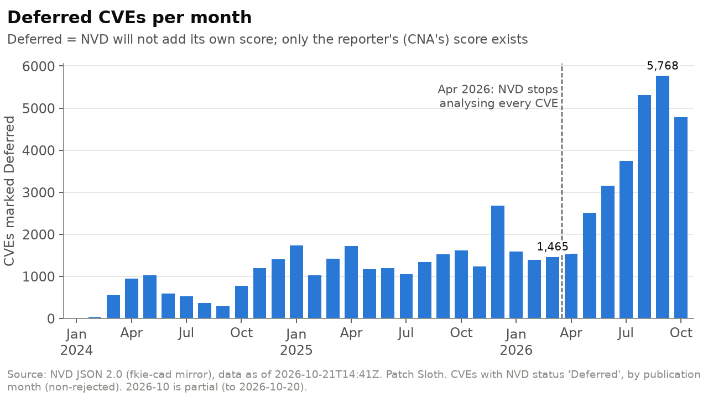
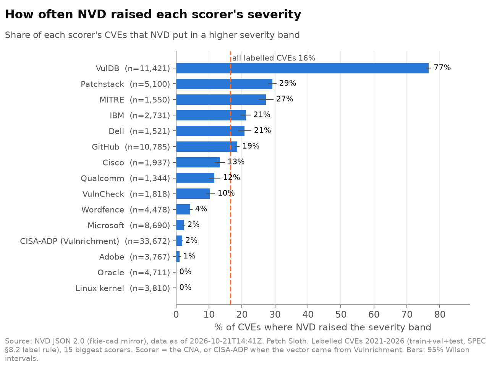
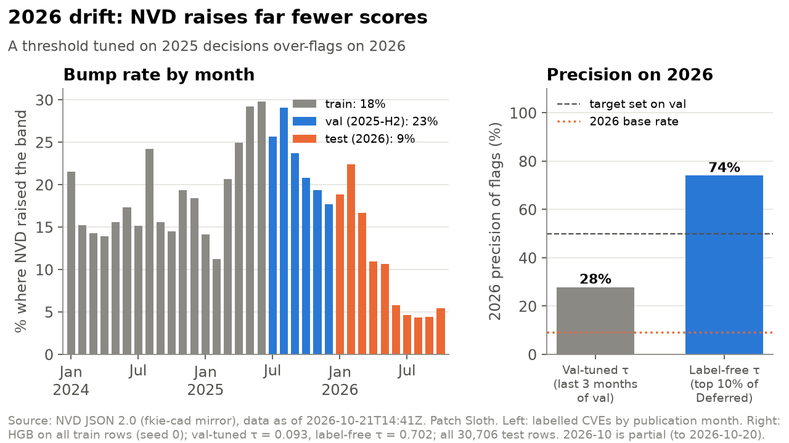
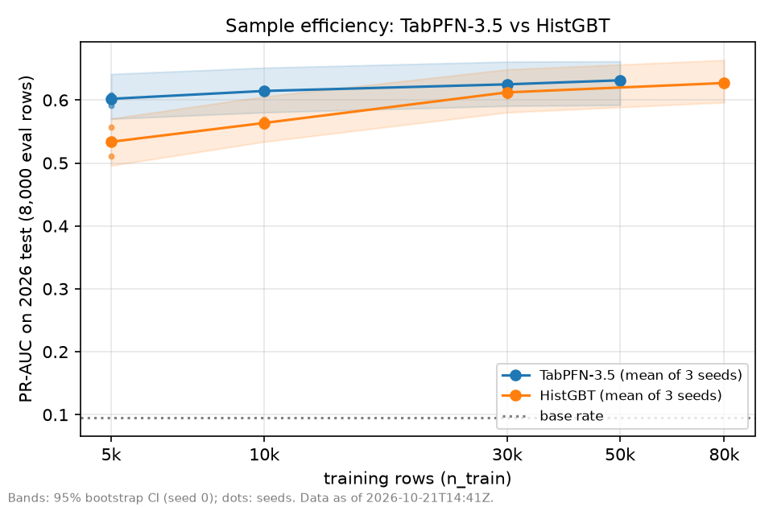

# Patch Sloth: a second opinion on CNA-only CVSS scores

Technical write-up. Every number below comes from a file in `results/` (mainly `final_table.md`, `costs.jsonl`,
`charts/charts_data.json` and `demo/`); design decisions and their reasons are in `DECISIONS.md`.
Evaluation snapshot: NVD data as of 2026-10-21.

## 1. Problem

Since April 2026, NIST's National Vulnerability Database (NVD) no longer analyses every CVE. Many are marked
**Deferred**. For those, the only severity score is the one from the CNA, the organisation that reported the
vulnerability (often the vendor itself).

- **Deferrals are climbing.** 1,465 new CVEs were Deferred in March 2026 and 5,768 in September; 26,809 from April
  to 20 October.
- **NVD writes its own score less and less.** For analysed CVEs with a CNA score, NVD wrote its own CVSS vector 94%
  of the time in January 2024, and 12% in September 2026.
- **When both scored, they often disagreed.** In 2025, NVD and the CNA disagreed on Confidentiality 49% of the
  time, Integrity 43% and Availability 40%; Attack Vector only 6%.
- **NVD usually disagreed upwards.** Across 122,459 labelled CVEs, NVD put 16.4% in a higher severity band than the
  CNA.



The rate depends heavily on the scorer: NVD raised 77% of VulDB's scores but 0.1% of Oracle's and the Linux
kernel's. The VulDB figure is mostly one convention gap: VulDB scores C/I/A impact Low/Low/Low where NVD scores
High/High/High. That accounts for 5,850 of the 8,747 raised VulDB CVEs, two thirds of them SQL injection
(`results/vuldb_check.md`).



NVD is not ground truth either: it tends to score the worst case, and some maintainers argue it
[inflates severity](https://daniel.haxx.se/blog/2023/03/06/nvd-makes-up-vulnerability-severity-levels/). So Patch
Sloth never says "the vendor is wrong". It estimates whether an independent NVD-style reviewer would likely rate a
CVE higher, and every output is labelled an estimate for triage.

## 2. System

Patch Sloth takes a `package-lock.json` or `requirements.txt` and sorts each CVE in it into patch now, this month,
or ignore for now.

```
                  nightly / batch                                 per request
 NVD feeds ──► dataset ──► fine-tuned Qwen3-8B (Tinker) ─┐
 CISA KEV  ──►         └──► TabPFN-3.5 stack ────────────┼─► feed: every unanalysed CVE
 EPSS      ──►                                           │    (band + predicted vector)
                                                         │
 your lockfile ──► scanner (GitHub Advisory DB) ──► CVE IDs ──► feed lookup
                                                         ──► priority rules (KEV, EPSS, band)
                                                         ──► LLM report + guardrail
```

- **Feed.** All 58,457 CVEs that NVD has not analysed (49,272 Deferred, plus Awaiting Analysis, Received and
  Undergoing Analysis) are scored in batch and published as a CSV and a parquet file in the GitHub release
  [`feed-2026-10-23`](https://github.com/MAUK9086/patch-sloth/releases/tag/feed-2026-10-23). The feed model is the
  TabPFN-3.5 + LLM-feature stack; CVEs not in the feed fall back to HistGBT trained on all training rows.
- **Priority rules are fixed code, not the LLM.** CISA KEV, EPSS ≥ 0.10, or a confident "likely under-rated" with a
  fix available gives P0; HIGH severity or a flag gives P1.
- **Report.** An LLM (Ultramarine 1 Flash) writes a short report. A guardrail checks that every CVE ID and number in
  the text appears in the input; on failure the report is retried once, then replaced by a template.
  `--no-llm` uses the template only and makes no paid calls.
- **Already-reviewed CVEs** are shown as "NIST-reviewed: CNA X / NVD Y" with no prediction.

**Demo scans** of three popular npm projects' current lockfiles (`results/demo/`; no issues were opened):

| Project | Dependencies | CVEs | Deferred CVEs | Report cost |
|---|---|---|---|---|
| markedjs/marked | 625 | 14 | 8 | $0.0012 |
| mochajs/mocha | 715 | 36 | 11 | $0.0024 |
| socketio/socket.io | 1,212 | 112 | 22 | $0.0077 |

These lockfiles include dev and example dependencies, so a listed CVE does not mean the published package is
affected.

## 3. Data and labels

239,058 CVEs from 2021–2026, split by publication date, never randomly: train before July 2025 (80,098),
validation 2025-H2 (11,655), test 2026 (30,706). The label is NVD's vector if NVD wrote one, otherwise the CNA's
vector that NVD reviewed and kept. A **bump** means the label's severity band is higher than the CNA's. Features
use only what is known about a CVE on the day it is published.

## 4. Results

### Headline

When Patch Sloth said "likely under-rated", NIST had raised the score **75% of the time (281 of 376)**, against a
**9.5%** base rate, on 8,000 CVEs from 2026. The "likely" cut-off is the top 10% of scores over Deferred CVEs, so
no labels are used to choose it. The "possible" band was confirmed 29% of the time and "unlikely" 3.8%.

### Fine-tuning Qwen3-8B to predict NVD's vector

LoRA on Qwen3-8B (rank 32, one epoch over 30,000 CVEs, 469 steps, $3.37 on Tinker). Severity accuracy is the share
of CVEs whose predicted vector lands in NVD's severity band; 8,000 CVEs per split.

| | Copy the CNA | Base Qwen3-8B | Fine-tuned |
|---|---|---|---|
| Validation (2025-H2) | 0.722 | 0.710 | **0.869** |
| Test (2026) | **0.880** | 0.865 | 0.859 |
| Bump F1, validation / test | 0 / 0 | 0.033 / 0.108 | **0.830 / 0.559** |

On 2025 data the fine-tune beats copying the CNA by a wide margin (McNemar p = 2e-143). **On 2026 it does not:**
copying the CNA is better (p = 2e-6), because in 2026 NVD changes far fewer CNA vectors. The fine-tune still
catches raises far better than the base model, and its JSON output was valid 100% of the time.

### The gate, and why the tuning window matters

A gate uses the LLM's vector only when the stacked model is confident, and keeps the CNA's otherwise. Two ways to
choose its threshold were specified before running anything, both using validation labels only:

| Threshold tuned on | Share of 2026 CVEs changed | 2026 severity accuracy vs copying the CNA |
|---|---|---|
| All of 2025-H2 | 99.7% | **−2.1 points** [−3.0, −1.3] |
| Last 3 months of 2025 | 6% | **+2.0 points** [+1.5, +2.5] |

Same model, different tuning window. The second rule holds in all 3 seeds and is the one used.



The same drift breaks plain probability thresholds: NVD raised 23% of 2025-H2 CVEs but 9% of 2026 ones. A
threshold tuned on late 2025 gave 28% precision on 2026; the label-free cut-off gave 74%.

### Ranking the CVEs NVD would raise

PR-AUC on the same 8,000 2026 CVEs (base rate 0.095; mean of 3 seeds):

| Model | PR-AUC |
|---|---|
| Fine-tuned LLM alone | 0.404 |
| TF-IDF + logistic regression | 0.426 |
| TabPFN-3.5 + LLM features (feed model) | 0.621 |
| HistGBT, all 80,098 rows | 0.627 |
| TabPFN-3.5, 50k rows | 0.631 |

With all the data, TabPFN and a fully trained HistGBT are not significantly different. TabPFN's advantage is
**sample efficiency**: at 5,000 and 10,000 training CVEs it beats HistGBT on the same rows by 0.05–0.08 in every
seed, and on 5,000 CVEs it reaches 0.602, 96% of HistGBT trained on all 80,098 rows, with no tuning.



### A frontier model, zero-shot

All models on the same 1,000 test CVEs:

| Model | Severity accuracy | Cost per 1,000 CVEs |
|---|---|---|
| Copy the CNA | 0.874 | $0 |
| Base Qwen3-8B | 0.865 | $0.063 |
| Fine-tuned Qwen3-8B | 0.861 | $0.045 (+ $3.37 training) |
| Ultramarine 1 Flash, zero-shot | 0.795 | $0.092 |

Zero-shot, the frontier model rewrites CNA vectors too often and is significantly worse than copying them
(p = 7e-11), so in Patch Sloth it only writes the reports.

## 5. What went wrong (and was fixed)

1. **A baseline smaller than its name.** For three milestones, "HistGBT on all training data" was trained on
   10,000 rows, because a command-line default meant for TabPFN applied to every model. Retrained on all 80,098
   rows, HistGBT scored 0.627 and removed most of TabPFN's accuracy lead, which is why the TabPFN result is stated
   as sample efficiency. The clue was HistGBT on a 30k subsample beating HistGBT on "everything".
2. **The NaN label bug.** The label rule began as `nvd_vector or cna_vector`. In pandas a missing string is NaN,
   and NaN is truthy, so every CVE NVD had accepted unchanged lost its label and the training set silently held
   only rescored CVEs. Explicit string checks fixed it (115,092 → 122,459 labelled rows); a regression test covers
   None, NaN and `pd.NA`.
3. **A test that passed on Windows and failed on Linux.** The advisory scanner read files in filesystem order
   (alphabetical on NTFS, hash order on ext4), so a package matching several advisories got a different "fixed"
   version per OS. The index is now built from a sorted list.

## 6. Limitations

- Every score is an estimate for triage, not an official CVSS score. The labels are NVD's decisions, and NVD tends
  to score the worst case.
- In 2026 NVD writes its own vector for far fewer CVEs, so some "kept the CNA score" labels may reflect less
  review rather than agreement.
- On 2026 CVEs, the fine-tuned model alone is less accurate than copying the CNA; only the gated version beats it.
- The guardrail checks facts, not meaning. In the socket.io demo, the summary called three CVEs "axios" (only one
  is) and counted 33 packages for the P1 list (33 is the scan total; P1 spans 24). Every number was in the input,
  so it passed. The P0/P1/P2 tables come from code and are unaffected.
- The LoRA weights were exported in PEFT format and vLLM's chat template matches the training prompt (200/200
  checked), but the vLLM conversion and end-to-end serving parity were not run.
- The error analysis (`results/error_sample_10.md`) uses a HistGBT + LLM stack (PR-AUC 0.609 vs 0.621 for the feed
  model), because the feed model's per-row predictions were lost with GPU access.
- Scope: CVSS v3.1 only; npm and PyPI only; no affected-product (CPE) lists; no exploitation prediction (EPSS is an
  input).
- The app runs locally (pip or Docker); it is not hosted. `deploy/` holds the container and App Platform configs.

## 7. Cost

| Item | Cost |
|---|---|
| Tinker: LoRA training (incl. dry run) | $3.38 |
| Tinker: evaluation sampling | $2.20 |
| Tinker: 58,457 unanalysed CVEs | $2.57 |
| Ultramarine: 1,000-CVE baseline + pilot | $0.09 |
| Ultramarine: reports | $0.015 |
| TabPFN, HistGBT | local, no metered cost |
| **Total metered** | **≈ $8.26** (+ ≤ $0.10 unlogged, interrupted Tinker run) |

## 8. Credits and prior work

- Data: NVD JSON 2.0 via the fkie-cad mirror; CISA KEV; EPSS (FIRST); GitHub Advisory Database (CC-BY 4.0); OSV /
  osv-scanner.
- Prior work: CISA Vulnrichment; VulnCheck's NVD backlog research; "Can LLMs Classify CVEs?" (arXiv 2504.10713).
- Built with Claude Code for the DEV Hacktoberfest 2026 Open-Source AI Challenge (week 3), where LLM assistance was
  allowed. The Claude Code sessions are stored as Entire checkpoints in this repository: fetch them with
  `git fetch origin 'refs/entire/*:refs/entire/*'`.
