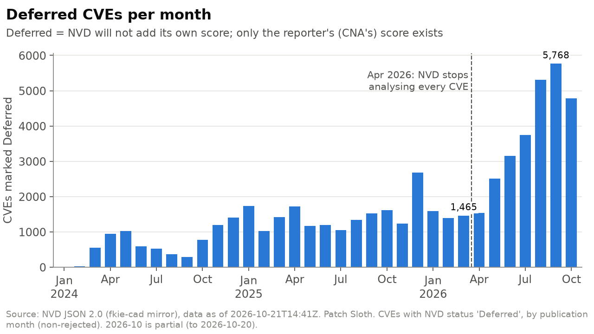
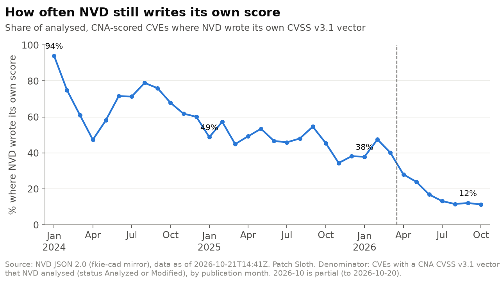
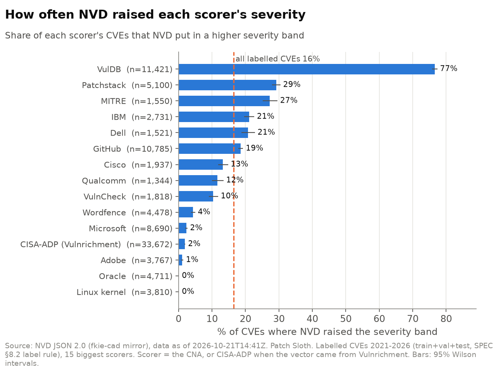
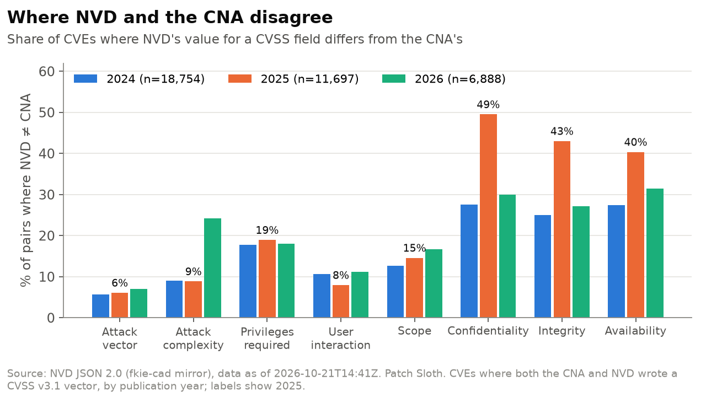
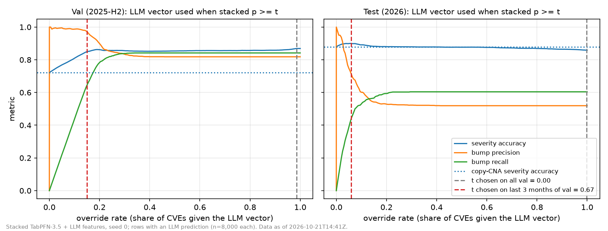
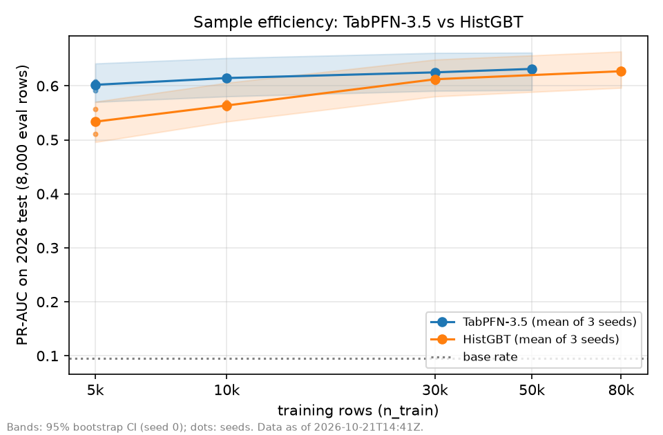
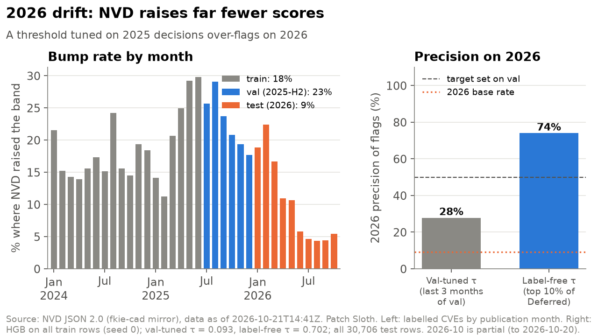

<!--
Post skeleton (SPEC §17). Structure + facts only: every bullet is a number taken from a file in results/ (named in
brackets). Prose, hook, voice and personal parts are Ahmad's: [AHMAD: ...]. Image paths are relative to this file;
upload them to DEV before publishing. Evaluation snapshot: NVD data as of 2026-10-21T14:41Z unless a bullet says
otherwise; the live feed is release feed-2026-10-23 (data as of 2026-10-23).
-->

# [AHMAD: title]

[AHMAD: cover image / tags: hf26challenge + partner tags]

## 1. Hook: NIST stopped checking

[AHMAD: hook, in your words. SPEC wording to riff on: "NIST stopped checking. Here's what that costs you."]

- CVEs marked Deferred, by publication month: 1,465 in Mar 2026 → 5,768 in Sep 2026; 26,809 from Apr to 20 Oct 2026. [`results/charts/charts_data.json` → `deferred_per_month`]

## 2. The problem, with evidence

[AHMAD: framing paragraph]

- Of the CNA-scored CVEs NVD analysed, NVD wrote its own CVSS v3.1 vector for 94% (Jan 2024), 49% (Jan 2025), 38% (Jan 2026) and 12% (Sep 2026). [`charts_data.json` → `nvd_own_score_rate`]
- Where both NVD and the CNA scored (2025, n = 11,697), they disagreed on Confidentiality 49%, Integrity 43%, Availability 40% and Attack Vector 6% of the time. [`charts_data.json` → `field_disagreement`; chart `03_field_disagreement.png`]
- Across 122,459 labelled CVEs (2021–2026), NVD's label put 16.4% in a higher severity band than the scorer. [`charts_data.json` → `bump_rate_by_scorer`]
- Bump rate by scorer ranges from 77% (VulDB, n = 11,421) to 0.1% (Oracle, n = 4,711; Linux kernel, n = 3,810); CISA-ADP (Vulnrichment) 1.9% (n = 33,672). [same; chart `04_bump_rate_by_scorer.png`]

- Sources to cite for the policy change (SPEC §17; read before quoting): [Help Net Security](https://www.helpnetsecurity.com/?p=366659), [CSA research note](https://labs.cloudsecurityalliance.org/research/csa-research-note-nist-nvd-enrichment-overhaul-20260429-csa/), [VulnCheck on backlog exploitation](https://us-gov-east-1.vulncheck.com/blog/nvd-backlog-exploitation-lurking). [AHMAD: pick the facts you quote from these]
- Honesty framing (SPEC §2): NVD is not ground truth and tends to score the worst case ([Daniel Stenberg](https://daniel.haxx.se/blog/2023/03/06/nvd-makes-up-vulnerability-severity-levels/)). The product says "an independent NVD-style reviewer would likely rate this higher", never "the vendor is wrong".

## 3. Who it's for

[AHMAD: personal: the lazy-but-responsible maintainer who ignores Dependabot because of alert fatigue]

## 4. Why it rewards laziness

[AHMAD: nobody re-scores 5,000 CVEs a month by hand, so the sloth does]

- The feed scores every unanalysed CVE nightly: 58,457 CVEs in release `feed-2026-10-23` (Deferred 49,272, Awaiting Analysis 6,604, Received 1,902, Undergoing Analysis 679). [`results/final_table.md` §6]

## 5. What I built

[AHMAD: architecture diagram, demo GIF, live URL]

- Input: a `package-lock.json` or `requirements.txt`. Output: P0 "patch now" / P1 "this month" / P2 "ignore for now", one reason per CVE, written by Ultramarine 1 Flash under a guardrail (every CVE ID and number must appear in the input). [SPEC §11]
- Demo scans of three public npm projects' current lockfiles (no issues opened): [`results/demo/README.md`]
  - markedjs/marked: 625 deps, 14 CVEs, 8 Deferred; report cost $0.0012; guardrail pass.
  - mochajs/mocha: 715 deps, 36 CVEs, 11 Deferred; 1 P0; report cost $0.0024; guardrail pass.
  - socketio/socket.io: 1,212 deps, 112 CVEs, 22 Deferred; report cost $0.0077; guardrail pass.
  - Caveat to state: lockfiles include dev/test/example dependencies.
- [AHMAD: screenshot of a report / web page]

## 6. How I know it works

### The headline

- When the served model said "likely under-rated", NIST had raised the band 75% of the time (281/376), vs a 9.5% base rate, on 8,000 2026 evaluation CVEs. The cut-off is label-free (top 10% of Deferred scores); it flags 4.7% of those rows. [`final_table.md` §7, `results/serving_stack.json`]
- Bands on the same rows: likely 0.747 observed bump rate, possible 0.294, unlikely 0.038. [`serving_stack.json`]

### Baseline ladder, Task A (predict NVD's vector; severity accuracy, n = 8,000) [`final_table.md` §1]

| Split | copy-CNA | base Qwen3-8B | fine-tuned Qwen3-8B |
|---|---|---|---|
| val (2025-H2) | 0.722 | 0.710 | **0.869** [0.861–0.876] |
| test (2026) | **0.880** | 0.865 | 0.859 [0.851–0.866] |

- McNemar vs copy-CNA: val p = 2e-143 (fine-tune better); test p = 2e-6 (copy-CNA better). [§1]
- Bump F1 (fine-tuned vs base): val 0.830 vs 0.033; test 0.559 vs 0.108. JSON valid 1.000. [§1]
- Gated override (use the LLM vector only when the stack is confident; threshold tuned on the last 3 months of val): test severity accuracy 0.899 vs copy-CNA 0.880, +2.0 points [1.5, 2.5] in all 3 seeds. [§4]

### Task B (rank CVEs NVD would raise; PR-AUC on 8,000 test rows, base rate 0.095) [`final_table.md` §2]

| Model (training rows) | PR-AUC (mean of 3 seeds) |
|---|---|
| copy-CNA | 0.095 |
| fine-tuned Qwen3-8B alone | 0.404 |
| TF-IDF + LR (all train) | 0.426 |
| HistGBT (all 80,098) | 0.627 |
| TabPFN-3.5 + LLM features (10k) | 0.621 |
| TabPFN-3.5 (50k) | 0.631 |

- TabPFN-3.5 (50k) vs HGB (80k): no significant difference (paired bootstrap, every-seed rule). Stack vs LLM alone: +0.22, significant. [§2]

### TabPFN scaling curve: sample efficiency [`final_table.md` §8]

- At 5k and 10k training rows TabPFN beats HGB on the same rows by +0.05 to +0.08 PR-AUC, significant in every seed.
- TabPFN on 5k rows: 0.602 vs HGB on 80k rows: 0.627 (96%, with 1/16 of the labels); the gap is significant in 2 of 3 seeds. From 30k rows on they are level.
- Calibration plot: `results/tabpfn_calibration.png`. [AHMAD: include or not]

### The 2026 drift, as a finding

- NVD's bump rate: train 18%, val (2025-H2) 23%, test (2026) 9%. [`charts_data.json` → `bump_rate_by_split`]
- HGB (all train), threshold tuned the SPEC way (precision ≥ 0.5 on the last 3 months of val): 2026 precision 28%, 30% of CVEs flagged. Label-free threshold (top 10% of Deferred): 2026 precision 74%, 4.4% flagged. [`charts_data.json` → `tau_drift_hgb_all_train`]
- Gated override tuned on all of val: −2.1 points vs copy-CNA on 2026; tuned on the last 3 months: +2.0. Same model, different tuning window. [`final_table.md` §4]

### Per-CNA results

- [TODO: model results by CNA (SPEC §10 breakdown) are not computed yet; only the data view (chart 04) exists.]

### Frontier zero-shot comparison (same 1,000 test rows) [`final_table.md` §3, `results/frontier_1k.json`]

| Model | Severity acc | $ per 1k CVEs |
|---|---|---|
| copy-CNA | 0.874 | 0 |
| fine-tuned Qwen3-8B | 0.861 | 0.045 (+ $3.37 training) |
| base Qwen3-8B | 0.865 | 0.063 |
| Ultramarine 1 Flash zero-shot | 0.795 | 0.092 |

- Ultramarine vs copy-CNA: McNemar p = 7e-11 (copy-CNA better). Fine-tuned vs copy-CNA on these rows: p = 0.32. [§3]

## 7. Why open matters

[AHMAD: your argument]

- Open-weight 8B model (Qwen3-8B) + LoRA rank 32 trained on 30,000 public NVD decisions for $3.37. [`results/tinker_run.json`, `results/costs.jsonl`]
- Inference: $0.045 per 1k CVEs on Tinker (fine-tuned) vs $0.092 per 1k for Ultramarine zero-shot, which is also less accurate here. [`final_table.md` §3]
- Whole unanalysed backlog: 58,457 CVEs scored for $2.571. [§6]
- Open feed: `latest.csv` / `second_opinion.parquet` as GitHub release assets (`feed-2026-10-23`). [§6]
- Self-hosting: vLLM parity vs Tinker [TODO: `results/vllm_parity.json` after Option A runs].

## 8. What went wrong [`final_table.md` §9]

[AHMAD: tell these in your voice]

- The "HistGBT" baseline was a 10k-row model for three milestones (a CLI default); HGB on all 80k rows scores 0.627, which erased most of TabPFN's accuracy lead.
- The NaN label bug: a truthiness check dropped labels; labelled rows 115,092 → 122,459 after the fix.
- A test passed on Windows and failed on Linux (filesystem order of `rglob`).
- The frontier baseline was first compared on different rows (1k vs 8k).
- Drift: thresholds tuned on 2025 do not transfer to 2026 (section 6).

## 9. Limitations

- Estimates for triage, not official scores.
- Label caveat: in 2026 NVD writes its own score far less often (12% in Sep 2026, chart 02); some "kept" labels may reflect less review, not agreement. [SPEC §8.2]
- NVD tends to score the worst case.
- CVSS v3.1 only; npm and PyPI only; no CPE generation; not an exploitation predictor (EPSS is an input field).
- The fine-tuned LLM alone does not beat copying the CNA on 2026 severity accuracy (0.859 vs 0.880).
- Error analysis: [TODO: tag counts from `results/error_sample.md` after the human tags them].

## 10. Prize categories

- **Tinker:** LoRA SFT of Qwen3-8B, 469 steps, $3.37; total Tinker spend logged $8.16 (SFT, dry run, M3 sampling, 58,457-CVE backlog) of the $10 credit. [`results/costs.jsonl`] [AHMAD: paragraph]
- **TabPFN:** TabPFN-3.5, sample efficiency (section 6), the stacked model behind the served bands. [AHMAD: paragraph]
- **DigitalOcean:** [TODO after deploy: live URL, $/hour, total hours] [AHMAD: paragraph]
- **Ultramarine:** report writer, $0.0012–$0.0077 per demo report with guardrail pass; frontier baseline $0.092 per 1k calls. [`results/demo/README.md`, `final_table.md` §3] [AHMAD: paragraph]
- **Entire:** session checkpoints pushed as `refs/entire/checkpoints/*`. [AHMAD: links to sessions]

## 11. Credits

- Data: NVD JSON 2.0 via the fkie-cad mirror (public domain); CISA KEV (public domain); EPSS (FIRST/Empirical); GitHub Advisory Database (CC-BY 4.0); OSV / osv-scanner (Apache-2.0).
- Prior work: CISA Vulnrichment; VulnCheck; "Can LLMs Classify CVEs?" (arXiv 2504.10713).
- The initial scaffold was produced in a Claude chat session before Entire was enabled. [SPEC §17]
- [AHMAD: Entire session links, DevRelay embed]
